<a href="https://github.com/i6moons/server-action-audit"></a>


I build web apps with Next.js and TypeScript, and I spend most of my time on their security: who can call what, and what happens when someone calls it who shouldn't. I write tools that catch these bugs, and when I find one in another project, I send the fix.

## server-action-audit

[](https://www.npmjs.com/package/server-action-audit) [](https://github.com/i6moons/server-action-audit/actions/workflows/ci.yml) [](https://github.com/marketplace/actions/server-action-audit)

In Next.js, every `"use server"` function is a public HTTP endpoint, and an auth check on the page does not protect it. server-action-audit lists every Server Action in a project and flags the ones that never check who is calling, or that use their input without validating it.


It follows your auth helpers across files and knows Auth.js, Clerk, Supabase, Better Auth, next-safe-action and Zod. It runs as a CLI, an ESLint plugin or a GitHub Action, with SARIF output and pull request comments. On five large open-source Next.js apps, it went through 456 Server Actions in about a second per app.

```sh
npx server-action-audit
```

## feexpay-server

[](https://www.npmjs.com/package/feexpay-server) [](https://github.com/i6moons/feexpay-server/actions/workflows/ci.yml) 

FeexPay's web SDKs take the secret key in the browser, and its webhooks are not signed. feexpay-server keeps the key on the server and re-reads every webhook from the status API before trusting it.

```ts
export const POST = createWebhookHandler({
  feexpay: getFeexPay,
  secret: () => process.env.FEEXPAY_WEBHOOK_SECRET,
  async onPayment({ transaction }) {
    // re-read from the status API, not taken from the webhook body
    await markOrderPaid(transaction.callbackInfo, transaction.reference, transaction.amount)
  },
})
```

It covers 17 Mobile Money networks in 6 countries and card payments, with zero dependencies, an offline sandbox simulator and 61 tests. It runs on Node.js, Next.js, Bun, Deno, Cloudflare Workers and Vercel Edge.

## Upstream

In [Poweradmin](https://github.com/poweradmin/poweradmin), a web interface for PowerDNS, my merged pull request [#1836](https://github.com/poweradmin/poweradmin/pull/1836) lets admins accept OIDC and SAML logins only when the configured claims match. It started as an answer in their Discussions; the maintainer turned it into an issue, and I implemented it.

Answers accepted in other projects' GitHub Discussions:

- **AWS** (aws-aspnet-cognito-identity-provider): [why the cookie expires with the Cognito tokens, and how to build a longer "Remember me" session](https://github.com/aws/aws-aspnet-cognito-identity-provider/discussions/323#discussioncomment-19216762)
- **Nextcloud** (all-in-one): [whether the AIO images would be patched for CVE-2026-111497](https://github.com/nextcloud/all-in-one/discussions/8923#discussioncomment-19219638)
- **Google** (elephant-goldfish-model): [storing and cleaning up the markdown artifacts of a workflow](https://github.com/google/elephant-goldfish-model/discussions/176#discussioncomment-19219515)
- **Avahi**: [avahi returning the wrong IPv4 address](https://github.com/avahi/avahi/discussions/999#discussioncomment-19219609)
- **Poweradmin**: [OIDC authentication](https://github.com/poweradmin/poweradmin/discussions/1819#discussioncomment-19305872)
- **antdv-next/x**: [an installation failure of @antdv-next/x-pro](https://github.com/antdv-next/x/discussions/260#discussioncomment-19219637)

## Tools

Burp Suite, nuclei, ffuf and Kali Linux for testing. TypeScript, Next.js, React, Node.js, Python, Docker and GitHub Actions for building.

I'm currently working through the PortSwigger Web Security Academy, towards the Burp Suite Certified Practitioner exam.

<br />

<div align="center">

<picture>
  <source media="(prefers-color-scheme: dark)" srcset="https://raw.githubusercontent.com/i6moons/i6moons/output/github-snake-dark.svg" />
  <source media="(prefers-color-scheme: light)" srcset="https://raw.githubusercontent.com/i6moons/i6moons/output/github-snake.svg" />
  
</picture>

</div>
