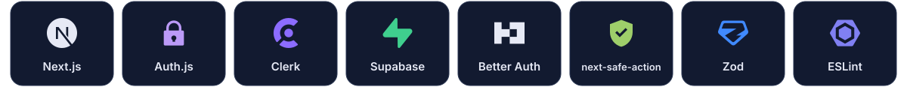
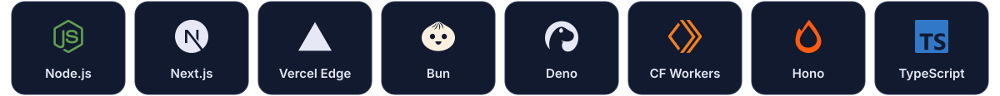
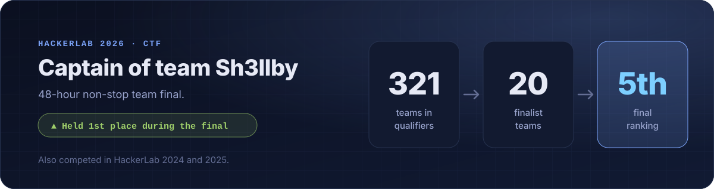
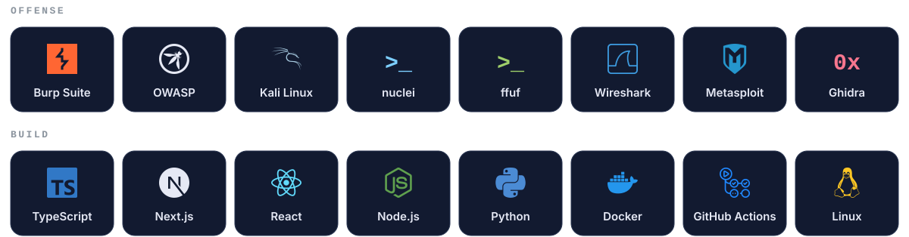

<a href="https://github.com/i6moons/server-action-audit"></a>

<p align="center">
  <a href="https://github.com/i6moons/server-action-audit"></a>&nbsp;
  <a href="https://github.com/i6moons/feexpay-server"></a>&nbsp;
  <a href="https://www.npmjs.com/~i6moons"></a>&nbsp;
  <a href="https://github.com/poweradmin/poweradmin/pull/1836"></a>
</p>

<br />


## The problems I work on

<table>
<tr>
<td width="33%" valign="top">

### 🔓 Every Server Action is a public endpoint

In Next.js, an auth check on the page does not protect the actions defined in it. Forget one `await auth()` and anyone can call `deletePost` with a POST request.

**→ [server-action-audit](https://github.com/i6moons/server-action-audit)** finds them.

</td>
<td width="33%" valign="top">

### 🔑 Payment keys end up in the browser

FeexPay's web SDKs take the secret key client-side, and its webhooks are not signed: a forged one can look like a real payment.

**→ [feexpay-server](https://github.com/i6moons/feexpay-server)** keeps the key on the server and re-checks every webhook.

</td>
<td width="33%" valign="top">

### 🪪 SSO lets in every user of the identity provider

Poweradmin, a web UI for PowerDNS, could not restrict OIDC and SAML logins to a group, a scope or a department.

**→ [poweradmin#1836](https://github.com/poweradmin/poweradmin/pull/1836)** (merged) admits a login only when the configured claims match.

</td>
</tr>
</table>

## Open-source security tools

<table>
<tr>
<td>

### [server-action-audit](https://github.com/i6moons/server-action-audit)

**Find the Next.js Server Actions that anyone can call.**

[](https://www.npmjs.com/package/server-action-audit) [](https://github.com/i6moons/server-action-audit/actions/workflows/ci.yml) [](https://github.com/marketplace/actions/server-action-audit) [](https://github.com/i6moons/server-action-audit/blob/main/LICENSE)


- Lists every `"use server"` function and flags the ones with **no authorization check** or **unvalidated input**.
- Follows your own auth helpers across files, re-exports and React `cache()`, up to 4 levels deep.
- **CLI · ESLint plugin · GitHub Action · SARIF for code scanning · sticky pull request comments.**
- Tested on 5 large open-source Next.js apps: **456 Server Actions, about a second per app.** It reads your code; it never runs it.



```yaml
# .github/workflows/security.yml
- uses: i6moons/server-action-audit@v0
```

</td>
</tr>
<tr>
<td>

### [feexpay-server](https://github.com/i6moons/feexpay-server)

**Accept Mobile Money and card payments without ever exposing your key.**

[](https://www.npmjs.com/package/feexpay-server) [](https://github.com/i6moons/feexpay-server/actions/workflows/ci.yml)  

```ts
export const POST = createWebhookHandler({
  feexpay: getFeexPay,
  secret: () => process.env.FEEXPAY_WEBHOOK_SECRET,
  async onPayment({ transaction }) {
    // the webhook body is never trusted: this transaction was re-read from the status API
    await markOrderPaid(transaction.callbackInfo, transaction.reference, transaction.amount)
  },
})
```

- **17 Mobile Money networks in 6 countries** (MTN, Moov, Wave, Orange…), plus card payments with a strict check of the checkout URL.
- The client **refuses to start in a browser**, and a sandbox key used in production is rejected at startup.
- Every webhook is **re-read from the status API** and its secret is compared in constant time.
- **Zero dependencies**, an offline sandbox simulator, and 61 tests.



</td>
</tr>
</table>

## Proof, not buzzwords

<table>
<tr>
<td align="center" valign="top" width="33%"><h1>456</h1><p>Server Actions analyzed in 5 large open-source Next.js apps</p><p><sub><a href="https://github.com/i6moons/server-action-audit#readme">server-action-audit</a></sub></p></td>
<td align="center" valign="top" width="33%"><h1>145</h1><p>automated tests across both packages, CI on Node 20, 22 and 24</p><p><sub><a href="https://github.com/i6moons/server-action-audit/actions">CI runs</a></sub></p></td>
<td align="center" valign="top" width="33%"><h1>0</h1><p>runtime dependencies in feexpay-server</p><p><sub><a href="https://www.npmjs.com/package/feexpay-server?activeTab=dependencies">npm</a></sub></p></td>
</tr>
<tr>
<td align="center" valign="top"><h1>1</h1><p>security feature merged upstream, in Poweradmin</p><p><sub><a href="https://github.com/poweradmin/poweradmin/pull/1836">PR #1836</a></sub></p></td>
<td align="center" valign="top"><h1>6</h1><p>accepted answers on GitHub Discussions, in repos of AWS, Google and Nextcloud</p><p><sub><a href="#research--community">list below</a></sub></p></td>
<td align="center" valign="top"><h1>#5</h1><p>HackerLab 2026 final, as team captain, out of 321 teams</p><p><sub><a href="#ctf">details</a></sub></p></td>
</tr>
</table>

## Research & community

I answer security and infrastructure questions in other projects' GitHub Discussions. Six answers were accepted:

| Repository | Stars | Question |
| --- | ---: | --- |
| **aws**/aws-aspnet-cognito-identity-provider | 227 | [Why cookie expiration is tied to Cognito tokens, and how to build longer "Remember me" sessions](https://github.com/aws/aws-aspnet-cognito-identity-provider/discussions/323#discussioncomment-19216762) |
| **google**/elephant-goldfish-model | 21.6k | [Storing and cleaning up the markdown artifacts of a workflow](https://github.com/google/elephant-goldfish-model/discussions/176#discussioncomment-19219515) |
| **nextcloud**/all-in-one | 10.8k | [Will the AIO images be patched for CVE-2026-111497?](https://github.com/nextcloud/all-in-one/discussions/8923#discussioncomment-19219638) |
| **avahi**/avahi | 1.5k | [avahi returns the wrong IPv4 address](https://github.com/avahi/avahi/discussions/999#discussioncomment-19219609) |
| **poweradmin**/poweradmin | 933 | [OIDC authentication](https://github.com/poweradmin/poweradmin/discussions/1819#discussioncomment-19305872): the maintainer then opened [#1822](https://github.com/poweradmin/poweradmin/issues/1822), which I implemented in [#1836](https://github.com/poweradmin/poweradmin/pull/1836) (merged) |
| **antdv-next**/x | 105 | [Installation failure of @antdv-next/x-pro](https://github.com/antdv-next/x/discussions/260#discussioncomment-19219637) |

## CTF



## Arsenal



## Now

&nbsp; **PortSwigger Web Security Academy**, working towards the **Burp Suite Certified Practitioner** (BSCP) exam.

<br />

<a href="https://github.com/i6moons/server-action-audit"></a>

<br />

<div align="center">

<picture>
  <source media="(prefers-color-scheme: dark)" srcset="https://raw.githubusercontent.com/i6moons/i6moons/output/github-snake-dark.svg" />
  <source media="(prefers-color-scheme: light)" srcset="https://raw.githubusercontent.com/i6moons/i6moons/output/github-snake.svg" />
  
</picture>

</div>
